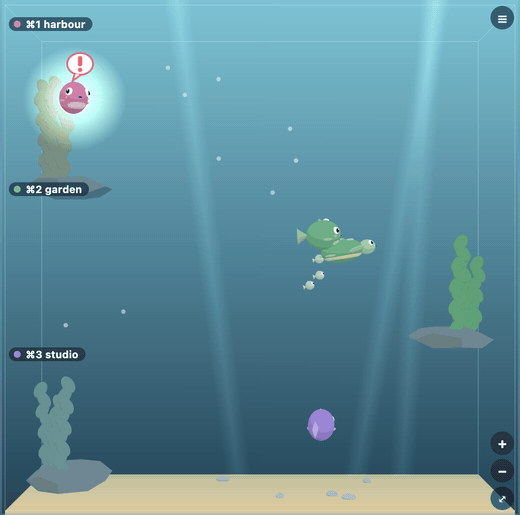
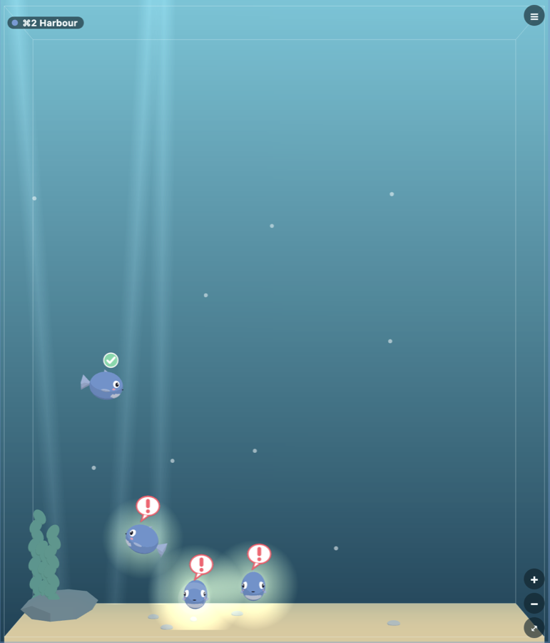
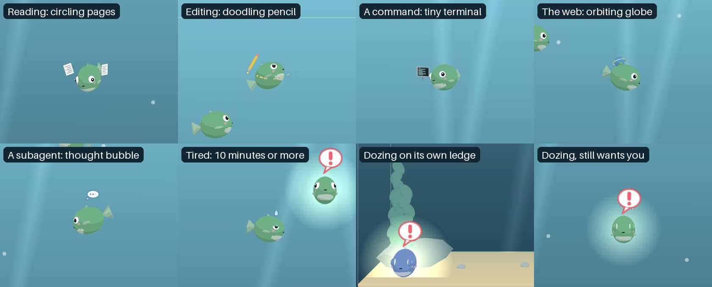
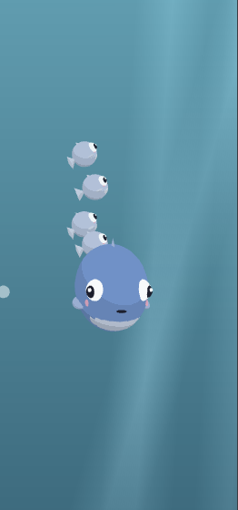

# Kelp Tank

Kelp Tank is a plugin for [Kelpi](https://github.com/benfriebe/kelpi), the terminal app. It shows each Claude Code session as a creature in a small 3D aquarium, so you can see at a glance which session needs you.




A session that only posted an update, left, wears a tick and does not glow. The three beside it want you.



- Each Kelpi workspace gets a rock ledge with its name, its shortcut and kelp in its colour.
- A session is a round fish. A session named after a day, such as `wed-15-10-2026`, is a turtle. A name containing `conduct` is a pufferfish with a crown, and a name ending in `rail-a`, `rail-b` and so on, or a handover such as `rail-r2`, is a tiny fish that follows its conductor.
- A name with a work word gets a fish with a prop: `brainstorming` wears a wizard cap, `building` a hard hat, `researching` carries an anglerfish's lantern, and `reviewing` or `auditing` is a boxfish in glasses. The word must be whole, separated by hyphens, as in `building-lantern-6a`.
- A working session swims around its ledge, and an idle one drifts slowly near it. A session waiting for you swims to the glass, glows and shows a "!" bubble. A session whose last reply ends `Awaiting you: 0` is only an update: it swims to the glass, wears a small tick for a moment, then rests. A waiting rail nudges its conductor instead, and a muted workspace never glows.
- A turn that has run 10 minutes or more looks tired: a slower swim, a drooping nose and a sweat drop. A waiting session Claude reports idle falls asleep on its own ledge with rising "z"s, keeping its glow and "!" if it wants you. A conductor stays awake while any rail in its workspace is still working. Rails never look tired or doze.
- Kelp Tank sorts Kelpi's sidebar for you, so the workspaces with a Claude session get the ⌘1 to ⌘9 shortcuts. Whatever workspace is first stays first. A workspace whose session starts moves up past the workspaces without one, to just under the last one with a session. Workspaces with sessions never swap places with each other, whatever their sessions are doing, so a workspace whose session ends falls below them. It sorts two seconds after a change. It takes every workspace out of its group into one flat list, leaving the empty group rows for you to delete, and moves a workspace you add into place too. It only ever moves workspaces; it never closes or deletes one.
- Click a creature to jump to its session. Pinch, ⌘-scroll or the + and − buttons zoom; plain scrolling moves around a tall tank. The menu hides workspaces.

## Install

Needs Kelpi 0.2.19 or later.

1. Download `kelp-tank.kelpi-plugin` from this repo's [Releases](../../releases) page.
2. Install it in Kelpi, either way:
   - Open **Settings → Plugins** and install the file.
   - Or run `kelpi plugin install kelp-tank.kelpi-plugin --trust` in a Kelpi terminal.
3. Show the tank in a sidebar with **Settings → Plugins → Workbench views**, or open it as a pane with `kelpi plugin open dita.kelp-tank dita.kelp-tank.home`.

**What trust means.** A Kelpi plugin's backend runs on your computer with your account's access, like any app you install. Kelp Tank's backend starts with Kelpi, lists your workspaces, listens to Kelpi's agent and state events, and moves workspaces to sort the sidebar. It reads the last line of each Claude reply to see whether it ends `Awaiting you: 0`, and keeps only which sessions that is true for, in memory. It never stores, logs or sends the reply. If you install the optional baby fish hook below, the backend also keeps and shares a little more; that section says exactly what. Its view reads your workspaces and sessions, saves its own settings in Kelpi, and focuses the pane you click. Install it only if you are happy to run its code, or read the source first.

## Baby fish (optional)

With one extra Claude Code hook, each background agent a session starts shows as a tiny baby fish swimming beside that session's creature. A baby fish leaves when its agent stops, when the session ends, or after 20 minutes with no sign of life from the agent. Hovering or clicking a baby fish acts on its parent session. The tank works without it: with no hook, it simply shows no baby fish.

The same hook shows what a working creature is doing: pages circle it while Claude reads or searches files, a pencil doodles round it while Claude edits, a tiny terminal scrolls beside it for a command, a globe orbits it on the web, and a "..." thought bubble floats above it while a subagent works. Rails and baby fish show the same props, each baby for its own agent's work. Without the hook, a working creature just swims.





1. Copy [`claude-hook/kelp-tank-hook.mjs`](claude-hook/kelp-tank-hook.mjs) from this repo somewhere on your computer. It needs Node 18 or later and nothing else.
2. Add these hooks to your Claude Code settings (for example `~/.claude/settings.json`), with the path to your copy:

```json
{
  "hooks": {
    "SubagentStart": [
      {
        "hooks": [
          { "type": "command", "command": "node /path/to/kelp-tank-hook.mjs", "async": true }
        ]
      }
    ],
    "SubagentStop": [
      {
        "hooks": [
          { "type": "command", "command": "node /path/to/kelp-tank-hook.mjs", "async": true }
        ]
      }
    ],
    "PreToolUse": [
      {
        "hooks": [
          { "type": "command", "command": "node /path/to/kelp-tank-hook.mjs", "async": true }
        ]
      }
    ],
    "PostToolUse": [
      {
        "hooks": [
          { "type": "command", "command": "node /path/to/kelp-tank-hook.mjs", "async": true }
        ]
      }
    ],
    "PostToolUseFailure": [
      {
        "hooks": [
          { "type": "command", "command": "node /path/to/kelp-tank-hook.mjs", "async": true }
        ]
      }
    ]
  }
}
```

If your settings already have a `hooks` object, add these five entries to it rather than replacing it.

**What the hook sends.** It runs `kelpi kelp-tank` with only the hook's event name, the session id, the agent id and the tool name. It never sends the tool's input or output, Claude's reply or any path. It prints nothing, does nothing outside a Kelpi pane, and returns without waiting for Kelpi. Kelp Tank's backend keeps each running agent's id, its session id and when it was last seen, and saves that in Kelpi's plugin storage so the baby fish survive a restart. On each call it also sends a `dita.kelp-tank.hook` event inside Kelpi, carrying the pane, workspace, event name, session id, agent id and tool name. Kelpi delivers plugin events to every running plugin and plugin view, so any plugin you trust can see that feed.

## Build from source

You need Node 24 and pnpm. Kelpi's command-line tool is not on npm, so build it from a checkout of Kelpi and point `KELPI_CLI` at it (or keep Kelpi at `~/apps/kelpi`).

```sh
pnpm install
pnpm check      # format, lint, typecheck, tests, build and package validation
pnpm package    # builds dist/ and packs it into kelp-tank.kelpi-plugin
```

`pnpm package` packs offline with Kelpi's CLI and never talks to a running Kelpi. Install the file as above.

Pushing a version tag such as `v1.0.0` runs `.github/workflows/release.yml`, which builds the same file and attaches it to a GitHub release.

## Credits

Kelp Tank is built on [Kelpi](https://github.com/benfriebe/kelpi) (github.com/benfriebe/kelpi). Kelpi's plugin SDK is not on npm, so `src/kelpi-api.ts` copies the parts of Kelpi's plugin types this plugin uses, from Kelpi at tag `v0.2.19`.

## Licence

MIT. See [LICENSE](LICENSE).
