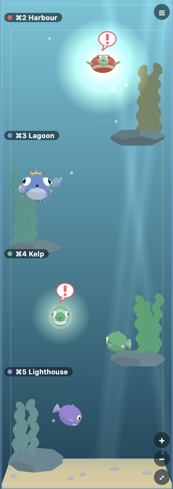

# Kelp Tank

Kelp Tank is a plugin for [Kelpi](https://github.com/benfriebe/kelpi), the terminal app. It shows each Claude Code session as a creature in a small 3D aquarium, so you can see at a glance which session needs you.



- Each Kelpi workspace gets a rock ledge with its name, its shortcut and kelp in its colour.
- A session is a round fish. A session named after a day, such as `wed-15-10-2026`, is a turtle. A name containing `conduct` is a pufferfish with a crown, and a name ending in `rail-a`, `rail-b` and so on, or a handover such as `rail-r2`, is a tiny fish that follows its conductor.
- A working session swims around its ledge, and an idle one drifts slowly near it. A session waiting for you swims to the glass, glows and shows a "!" bubble. A waiting rail nudges its conductor instead, and a muted workspace never glows.
- Click a creature to jump to its session. Pinch, ⌘-scroll or the + and − buttons zoom; plain scrolling moves around a tall tank. The menu hides workspaces.

## Install

Needs Kelpi 0.2.19 or later.

1. Download `kelp-tank.kelpi-plugin` from this repo's [Releases](../../releases) page.
2. Install it in Kelpi, either way:
   - Open **Settings → Plugins** and install the file.
   - Or run `kelpi plugin install kelp-tank.kelpi-plugin --trust` in a Kelpi terminal.
3. Show the tank in a sidebar with **Settings → Plugins → Workbench views**, or open it as a pane with `kelpi plugin open dita.kelp-tank dita.kelp-tank.home`.

**What trust means.** A Kelpi plugin's backend runs on your computer with your account's access, like any app you install. Kelp Tank's backend only lists your workspaces. Its view reads your workspaces and sessions, saves its own settings in Kelpi, and focuses the pane you click. Install it only if you are happy to run its code, or read the source first.

## Build from source

You need Node 24 and pnpm. Kelpi's command-line tool is not on npm, so build it from a checkout of Kelpi and point `KELPI_CLI` at it (or keep Kelpi at `~/apps/kelpi`).

```sh
pnpm install
pnpm check      # format, lint, typecheck, tests, build and package validation
pnpm package    # builds dist/ and packs it into kelp-tank.kelpi-plugin
```

`pnpm package` packs offline with Kelpi's CLI and never talks to a running Kelpi. Install the file as above.

Pushing a version tag such as `v1.0.0` runs `.github/workflows/release.yml`, which builds the same file and attaches it to a GitHub release.

## Credits

Kelp Tank is built on [Kelpi](https://github.com/benfriebe/kelpi) (github.com/benfriebe/kelpi). Kelpi's plugin SDK is not on npm, so `src/kelpi-api.ts` copies the parts of Kelpi's plugin types this plugin uses, from Kelpi at tag `v0.2.19`.

## Licence

MIT. See [LICENSE](LICENSE).
